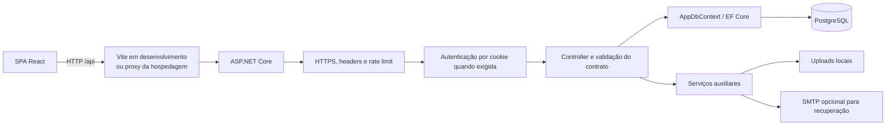

# Arquitetura da aplicação

## Visão geral

O WebYugi é composto por uma API REST ASP.NET Core no repositório backend e uma SPA React/TypeScript no repositório frontend. A SPA consome a API por HTTP; em desenvolvimento, o Vite encaminha `/api` e `/uploads` para o backend. Em produção, o encaminhamento equivalente depende da configuração de hospedagem.

## Organização do backend

- **Controllers** recebem requisições, aplicam autorização, coordenam regras e retornam códigos HTTP/DTOs. Não há uma camada de aplicação ou Repository abrangente.
- **DTOs** definem os dados de entrada e saída dos endpoints.
- **Model** contém as entidades persistidas e enums de catálogo/seção.
- **Infrastructure/AppDbContext** configura o mapeamento do Entity Framework Core e os relacionamentos.
- **Migrations** versionam alterações do schema PostgreSQL.
- **Services** fornecem funcionalidades auxiliares: armazenamento local e validação de imagens, envio de e-mail e migração em background de senhas legadas.
- **Program.cs** registra dependências, autenticação por cookie, rate limiting, middlewares, arquivos estáticos e controllers.

As regras de cadastro/autenticação ficam principalmente em `UsersController`; busca e manutenção do catálogo em `CardsController`; propriedade dos recursos e limites de deck em `DeckController`; e favoritos em `FavoritesController`. A persistência é acessada via `AppDbContext`.

## Fluxo de requisição

O fluxo depende do endpoint: por exemplo, leitura do catálogo é pública, enquanto decks, favoritos e operações de escrita exigem autenticação. A resposta volta como DTO/JSON e status HTTP. Imagens são servidas separadamente em `/uploads`.

## Autenticação e autorização

O login emite o cookie `WebYugiAuth` (HttpOnly, SameSite=Lax, validade deslizante de oito horas). A API não usa JWT. As rotas de decks e favoritos exigem sessão e restringem os dados à conta autenticada. O catálogo pode ser lido anonimamente; qualquer conta autenticada pode criar, editar ou apagar cartas, pois não há papel administrativo no código atual. Login e endpoints de recuperação compartilham uma política de limite por IP.

O frontend usa `fetch` com credenciais incluídas e consulta `/users/me` para validar a sessão. A implementação não configura CORS; o fluxo documentado utiliza proxy na origem da SPA.

## Regras de domínio observadas

- Um deck pertence a um usuário e suas entradas referenciam cartas.
- As entradas de deck têm seção `Main`, `Extra` ou `Side`; a quantidade precisa ser positiva. O backend limita o total a 60 e aplica limite padrão de três cópias por carta. A resposta indica validade quando o total fica entre 40 e 60; o deck pode permanecer incompleto durante a montagem.
- Favoritos são individuais por usuário e carta.
- Uma carta referenciada em deck não pode ser apagada; usuários e decks removidos apagam relações dependentes conforme as regras de cascade configuradas.
- Não há implementação de banlists nem regras específicas por formato identificadas no código.

Para entidades, campos e cardinalidades, consulte [Modelo de dados](../database/README.md). Rotas estão no [README principal](../../README.md) e na [referência da API](../api/README.md).

## Limites desta documentação

Não há implantação de produção ou diagrama de infraestrutura versionado nos repositórios examinados. O desenho acima representa o fluxo da aplicação configurada, não uma topologia de hospedagem específica.
