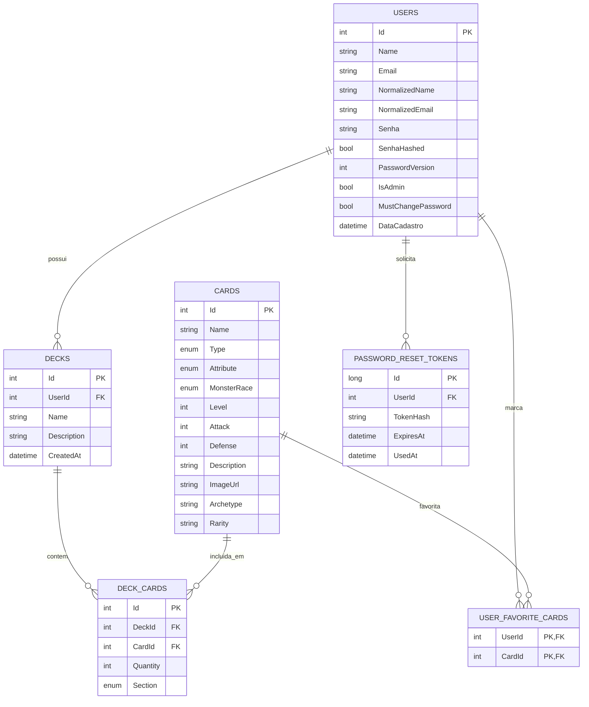

# Modelo de dados

O modelo abaixo reflete as entidades e relações configuradas em `AppDbContext` e nas migrations atuais. Campos listados são os atributos de domínio principais; índices e restrições relevantes aparecem nas notas.

## Entidades

| Entidade | Responsabilidade |
|---|---|
| `Users` | Conta, identificadores normalizados, estado de senha/sessão e flag `IsAdmin`. `MustChangePassword` é mantida por compatibilidade, mas não condiciona o acesso administrativo. `SenhaHashed` distingue contas legadas durante migração. |
| `Card` | Registro do catálogo, incluindo tipo, atributos, estatísticas, descrição e metadados de imagem/arquetipo/raridade. |
| `Deck` | Deck pertencente a um usuário, com nome, descrição opcional e data de criação. |
| `DeckCard` | Associação entre deck e carta, com quantidade e seção; unicidade por deck/carta/seção. |
| `UserFavoriteCard` | Associação de favorito com chave primária composta por usuário e carta. |
| `PasswordResetToken` | Token de redefinição persistido como hash, com validade e data opcional de uso. |

## Integridade e persistência

Para criar um banco Neon vazio com o schema correspondente às migrations atuais, execute [`neon-schema.sql`](neon-schema.sql) uma única vez no SQL Editor do Neon. O script também registra essas migrations em `__EFMigrationsHistory`; portanto, a API pode iniciar sem tentar recriar as tabelas.

- Índices únicos filtrados protegem `NormalizedEmail` (comprimento de 3 a 254) e `NormalizedName` (3 a 100). O filtro permite preservar identificadores legados fora dos limites atuais sem duplicar valores válidos normalizados.
- `DeckCard` tem índice único composto `(DeckId, CardId, Section)` e restrição `Quantity > 0`.
- Excluir usuário remove decks, favoritos e tokens associados por cascade. Excluir deck remove suas entradas. Excluir carta é restrito quando ela aparece em deck; favoritos da carta são removidos por cascade.
- Imagens são arquivos no diretório `uploads/cartas`, não conteúdo armazenado no PostgreSQL.
- `IsAdmin` e `MustChangePassword` são colunas da tabela `users`, adicionadas pela migration `AddAdminRole` com padrão `false` para preservar as contas existentes.
- A aplicação cria o administrador inicial no startup após as migrations estarem aplicadas.
- Migrations versionam a estrutura, mas a aplicação não as executa automaticamente e não inclui carga inicial de cartas.

Enums armazenados como texto incluem tipo/atributo/raça da carta e seção do deck. Consulte `Model/Enums/CatalogEnums.cs` para o conjunto de valores vigente. O [README principal](../../README.md) descreve os comandos de migration.
